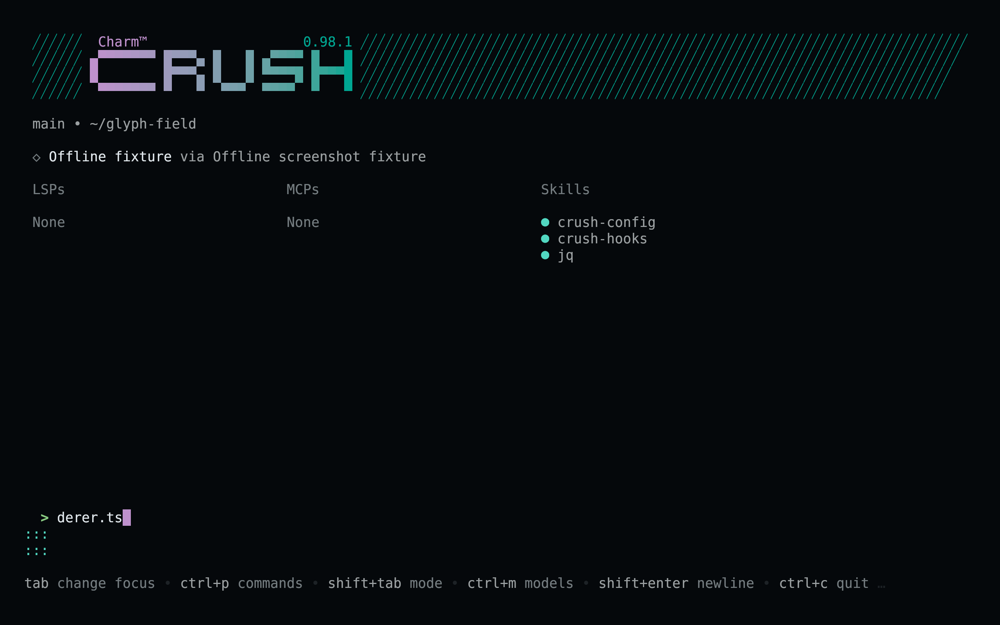
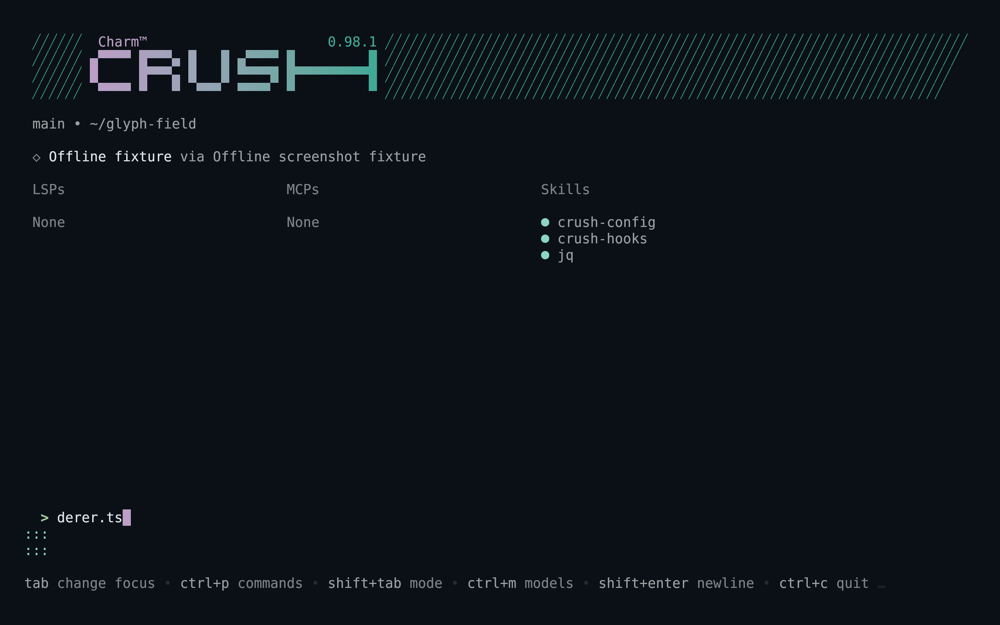
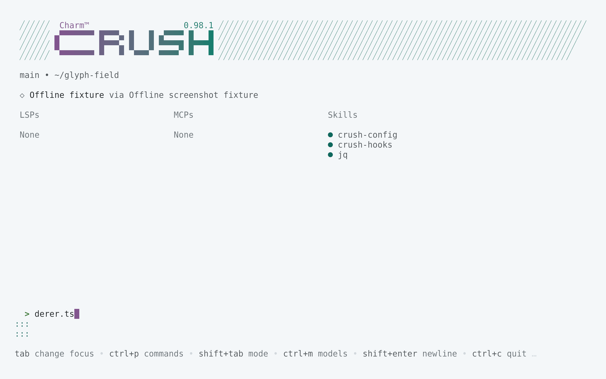
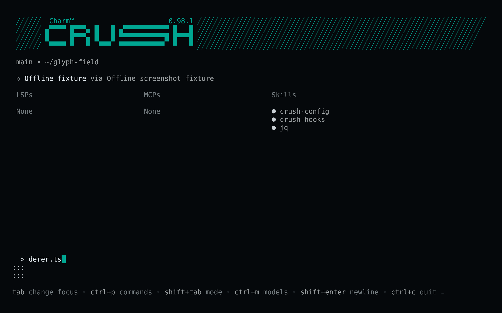

<!-- living-code-readme:1 -->
# 💘 Living Code for Crush

**Calm slate. Living color.** Living Code for Crush: complete native palette files with UI surfaces, status colors, review diffs and all sixteen ANSI colors.

[Installation](#installation) · [Flavors](#flavors) · [Configuration](#configuration) · [All ports](https://github.com/living-code-theme)

## Previews

<table data-lc-flavors>
<tr>
<td width="50%" valign="top">
<strong>Night</strong><br><sub>Dark · full palette</sub><br><br>
<a href="images/night.png"></a>
</td>
<td width="50%" valign="top">
<strong>Frost</strong><br><sub>Dark · softer chroma</sub><br><br>
<a href="images/frost.png"></a>
</td>
</tr>
<tr>
<td width="50%" valign="top">
<strong>Paper</strong><br><sub>Light · near-white slate</sub><br><br>
<a href="images/paper.png"></a>
</td>
<td width="50%" valign="top">
<strong>Signal</strong><br><sub>Dark · teal accent</sub><br><br>
<a href="images/signal.png"></a>
</td>
</tr>
</table>

Select any preview to view the image at full size.

## Installation

```sh
flavor=night # night, frost, paper, or signal
theme_dir="${CRUSH_GLOBAL_CONFIG:-${XDG_CONFIG_HOME:-$HOME/.config}/crush}/themes"
curl -fsSL --create-dirs -o "$theme_dir/living-code-$flavor.json" "https://raw.githubusercontent.com/living-code-theme/crush/main/themes/living-code-$flavor.json"
```

Open Crush, press **Ctrl+P**, choose **Themes**, and select `living-code-night` or the flavor you downloaded. `CRUSH_GLOBAL_CONFIG` is a **directory**, not a config filename; its `themes/` subdirectory is used when set. On other platforms, place `themes/` inside Crush’s global config directory. Existing config is not replaced.

## Flavors

Expand a flavor for its full-size preview and activation instructions.

<details data-lc-flavor="night">
<summary><strong>Night</strong> · Dark · full palette</summary>

<p><a href="images/night.png"></a></p>

Choose `living-code-night` in **Ctrl+P → Themes**.

</details>

<details data-lc-flavor="frost">
<summary><strong>Frost</strong> · Dark · softer chroma</summary>

<p><a href="images/frost.png"></a></p>

Choose `living-code-frost` in **Ctrl+P → Themes**.

</details>

<details data-lc-flavor="paper">
<summary><strong>Paper</strong> · Light · near-white slate</summary>

<p><a href="images/paper.png"></a></p>

Choose `living-code-paper` in **Ctrl+P → Themes**.

</details>

<details data-lc-flavor="signal">
<summary><strong>Signal</strong> · Dark · teal accent</summary>

<p><a href="images/signal.png"></a></p>

Choose `living-code-signal` in **Ctrl+P → Themes**.

</details>

## Configuration

For a persistent config selection, merge the following into your existing Crush config:

```json
{ "options": { "tui": { "active_theme": "living-code-night" } } }
```

The files specify every public `Palette` field and do not rely on an unrelated base theme. Diff code and gutter backgrounds have independent tints, and raw terminal output gets all sixteen Living Code ANSI colors.

## Compatibility

Requires a Crush release supporting standalone JSON theme files and `options.tui.active_theme`. This API was verified against the source revision recorded in `test/fixtures/upstream.json`; older builds without custom themes need an update. The field contract is extracted from Crush’s own palette implementation. No custom providers or credentials are installed.

Previews are captured programmatically from the actual application in an isolated profile. See [`capture/app.py`](capture/app.py) for the app-owned recipe and [`images/capture.json`](images/capture.json) for runtime, palette and image provenance. No mock interface is drawn.

## Contributing

Found a problem? [Open an issue](https://github.com/living-code-theme/crush/issues/new/choose) with the app version, the flavor and a screenshot. Want Living Code somewhere else? [Request a port](https://github.com/living-code-theme/core/issues/new?template=port-request.yml).

Pull requests are welcome. Keep this README, `port.json` and `images/` in sync, and use real screenshots of the app, never mockups.

🦎 **One chameleon, many habitats.** Part of [Living Code](https://github.com/living-code-theme).

## License

[MIT](LICENSE) © Elliot Luque
